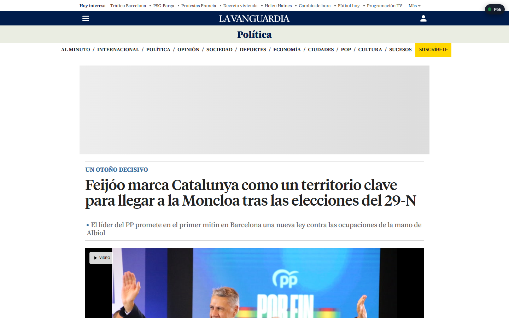
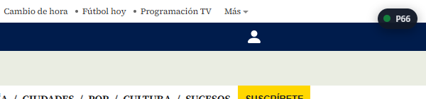
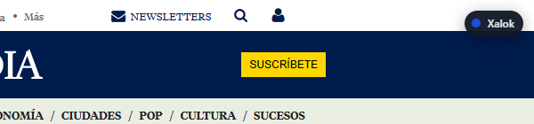
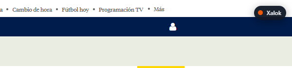
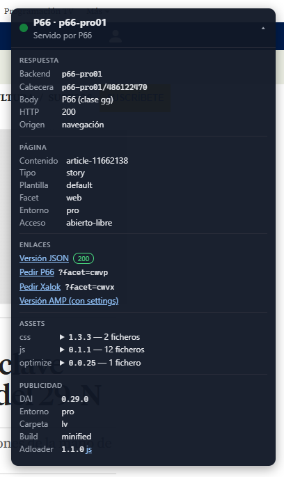
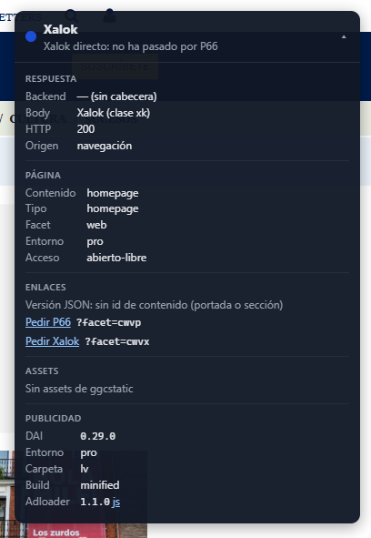
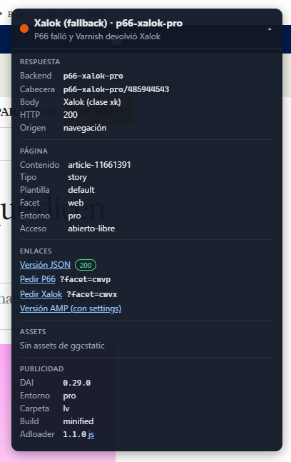

# Solicitud: permitir la extensión "P66 Render Inspector" en Chrome corporativo

| | |
|---|---|
| **Extensión** | P66 Render Inspector (versión 1.2.0, Manifest V3) |
| **ID de la extensión** | `ilhlmkjikoindjjhdjgmpnfojckggjcd` |
| **Instalación** | Sin empaquetar (carpeta del repositorio interno `p66-render-inspector`) |
| **Usuarios** | Equipo de desarrollo P66, PMs y QA de La Vanguardia y Mundo Deportivo |
| **Solicitante** | Enric Garay |

---

## Qué pedimos

Que la política de Chrome gestionado permita instalar la extensión con ID **`ilhlmkjikoindjjhdjgmpnfojckggjcd`** a los usuarios del equipo.

El ID es fijo: el `manifest.json` lleva una clave pública (`key`), así que la extensión tiene el mismo ID en cualquier PC y desde cualquier carpeta. Si actualizamos la versión, el ID no cambia y no hay que volver a pedir nada.

---

## Qué es

Una extensión que muestra, en cada página de La Vanguardia y Mundo Deportivo, **qué sistema ha servido esa página**:

- **P66**: el nuevo render.
- **Xalok**: el render antiguo, sin pasar por P66.
- **Xalok como fallback**: P66 ha fallado y Varnish ha devuelto Xalok.

Lo indica con un widget pequeño en la esquina de la página, con un color por estado. Al desplegarlo muestra el detalle: cabecera de respuesta, datos de la página, versiones de CSS/JS y versión de la librería de publicidad (DAI).



---

## El problema

Durante la migración de Xalok a P66 conviven los dos sistemas. Desde el navegador **no se ve qué sistema ha servido una página**: el dato va en la cabecera HTTP `X-Backend-Response`, que solo se consulta abriendo las DevTools (pestaña Network) o con `curl`.

Esto genera tres problemas:

1. **Los PMs y QA no pueden comprobarlo solos.** No usan DevTools en el día a día y acaban preguntando al equipo de desarrollo página a página.
2. **Los fallbacks pasan desapercibidos.** Cuando P66 falla, el usuario ve la página igual (la sirve Xalok), así que nadie lo reporta. Solo se detecta si alguien mira la cabecera.
3. **Revisar una incidencia cuesta varios pasos.** Para saber qué versión de assets o de DAI lleva una página hay que buscar en el código fuente las URLs de ggcstatic y de `dai.grupogodo.com`.

---

## Qué se ve en pantalla

### Los tres estados (widget plegado)

| Estado | Pantallazo | Significa |
|---|---|---|
| Verde · **P66** |  | La página la sirve P66. |
| Azul · **Xalok** |  | La sirve Xalok directamente, no ha pasado por P66. |
| Naranja · **Xalok (fallback)** |  | P66 ha fallado y se ha servido Xalok. Es el caso que hay que reportar. |

El icono de la extensión en la barra de Chrome también cambia al color y texto del estado (`P66`, `XK`, `FB`).

### Detalle (widget desplegado)

| P66 | Xalok | Xalok (fallback) |
|---|---|---|
|  |  |  |
| [Artículo de Política](https://www.lavanguardia.com/politica/20261019/11662138/feijoo-marca-catalunya-territorio-clave-llegar-moncloa-elecciones-29-n.html) | [Portada](https://www.lavanguardia.com/) | [Artículo de Comprar](https://www.lavanguardia.com/comprar/finanzas/20261020/11661391/prestamos-similares-creditio-mejores-alternativas-mkt-witm.html) |

Qué contiene cada bloque:

- **Respuesta**: servidor que ha respondido (`p66-pro01`, `p66-xalok-pro`…), cabecera completa y código HTTP.
- **Página**: id del contenido, tipo, plantilla, entorno y tipo de acceso.
- **Enlaces**: versión JSON del contenido en P66 (con su código de respuesta) y la misma URL forzando P66 o Xalok para comparar.
- **Assets**: versiones de CSS, JS y optimize que carga la página.
- **Publicidad**: versión, entorno y build de DAI y del adloader.

---

## Para qué lo usa cada perfil

| Perfil | Uso |
|---|---|
| **PMs** | Validar qué secciones y plantillas ya salen por P66. Detectar y reportar fallbacks con captura, sin pedir ayuda a desarrollo. |
| **QA** | Comprobar en `tes` (`.biz`) y `pro` (`.com`) que una página sale por el sistema esperado y con la versión de assets desplegada. |
| **Desarrollo** | Diagnosticar incidencias: backend, versión de assets, versión de DAI y errores ESI de un vistazo, y saltar a la versión JSON del contenido. |

---

## Permisos y seguridad

| Permiso | Para qué |
|---|---|
| `webRequest` | Leer la cabecera `X-Backend-Response` del documento principal. Solo lectura: no bloquea ni modifica peticiones. |
| `storage` | Guardar el estado de cada pestaña y si el widget está plegado o en qué esquina. |
| Acceso a sitios: `*.lavanguardia.com`, `*.lavanguardia.biz`, `*.mundodeportivo.com`, `*.mundodeportivo.biz` | La extensión **solo se ejecuta en estos dominios**. En el resto de webs no hace nada. |

- No envía datos fuera de esos dominios. La única petición propia es comprobar que la versión JSON (`p66.lavanguardia.com`, etc.) responde.
- No lee cookies, formularios, historial ni contraseñas.
- No usa servidores externos ni analítica.
- El código es interno y está en el repositorio `p66-render-inspector`; se puede revisar antes de aprobarla.

---

## Configuración necesaria en la política

La extensión se instala sin empaquetar (no está en Chrome Web Store), así que hacen falta dos cosas para los usuarios del equipo:

1. **Permitir el ID** en la lista blanca de extensiones (`ExtensionInstallAllowlist`, o la entrada equivalente en `ExtensionSettings`):

   ```json
   {
     "ExtensionInstallAllowlist": ["ilhlmkjikoindjjhdjgmpnfojckggjcd"]
   }
   ```

2. **Permitir el modo desarrollador** en `chrome://extensions` (`ExtensionDeveloperModeSettings` = `0`), necesario para cargar una extensión sin empaquetar. Si no se quiere abrir a toda la compañía, basta con aplicarlo a la unidad organizativa o grupo del equipo.

Si preferís distribuirla de otra forma (por ejemplo, publicada de forma privada para el dominio e instalada por política), nos adaptamos; en ese caso el ID lo asignaría la Web Store y os lo pasaríamos de nuevo.
